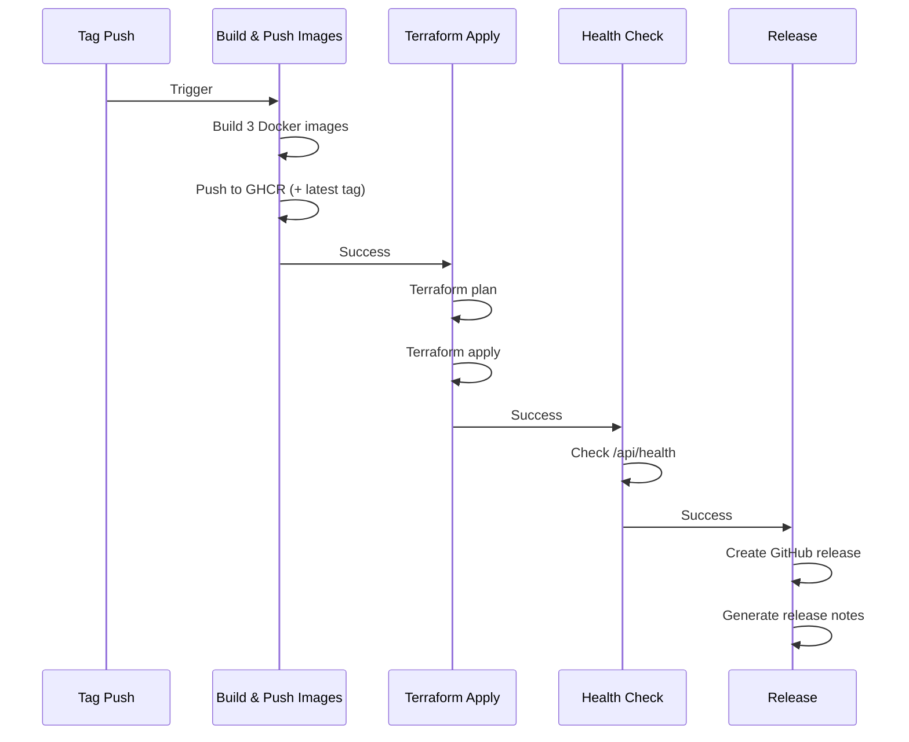

# Deploying to Production

This guide explains how the warehouse is deployed to production via GitHub Actions.

## Workflow Overview

The [deploy.yml](https://github.com/compilerla/warehouse/blob/main/.github/workflows/deploy.yml) workflow supports three trigger modes:

| Trigger                        | Description                                                      | Jobs Run                                          |
| ------------------------------ | ---------------------------------------------------------------- | ------------------------------------------------- |
| **Pull Request**               | Any PR touching `metabase/**`, `ingestion/**`, or `terraform/**` | `terraform-plan` (plan + comment)                 |
| **Tag Push**                   | Tags matching `202[6-9].[0-9][0-9].[0-9]+` (e.g., `2026.11.8`)   | All jobs                                          |
| **Manual (workflow_dispatch)** | Manual trigger from GitHub UI                                    | `build-images`, `terraform-apply`, `health-check` |

### Concurrency

The workflow uses a concurrency group (`${{ github.workflow }} - ${{ github.ref }}`) with `cancel-in-progress: true`. This ensures that only one run per branch/tag is active; newer runs cancel older ones.

---

## PR Plan (Pull Request Triggers)

When a PR touches any of the tracked paths, the `terraform-plan` job runs automatically:

1. **Authenticates** to GCP via Workload Identity Federation (WIF).
2. **Fetches** the latest release tag SHA from the GitHub API (falls back to `"latest"`).
3. **Runs** `terraform plan` with the latest image tags.
4. **Posts** a summary comment on the PR using [tf-summarize](https://github.com/kishaningithub/tf-summarize), showing the infrastructure changes in markdown. If a comment already exists, it is updated in place.

This gives reviewers a quick overview of infrastructure changes before merging.

---

## Automated Deployment (Tag Push)

Production deployments are triggered automatically by pushing a release tag matching the pattern `202[6-9].[0-9][0-9].[0-9]+` (e.g., `2026.11.8`, `2027.01.15`). The tag must also be accompanied by changes in at least one of the tracked directories (`metabase/`, `ingestion/`, `terraform/`).

### Job Dependency Chain

### Step 1: Build & Push Images

The `build-images` job builds and pushes three Docker images to GitHub Container Registry (GHCR):

| Image                                                | Dockerfile                   | Tag                   |
| ---------------------------------------------------- | ---------------------------- | --------------------- |
| `ghcr.io/compilerla/warehouse/metabase:<sha>`        | `metabase/Dockerfile`        | Commit SHA + `latest` |
| `ghcr.io/compilerla/warehouse/ingestion/base:<sha>`  | `ingestion/Dockerfile.base`  | Commit SHA + `latest` |
| `ghcr.io/compilerla/warehouse/ingestion/toggl:<sha>` | `ingestion/Dockerfile.toggl` | Commit SHA + `latest` |

Details:

- **Build arguments**: Each image receives `IMAGE_CREATED` (ISO 8601 UTC timestamp) and `IMAGE_VERSION` (tag name for release tags, or `github.sha` for manual triggers).
- **Layer caching**: GitHub Actions cache (`type=gha`) is used for both `cache-from` and `cache-to` (max mode) to speed up subsequent builds.
- **`latest` tag**: Every build also pushes a `latest` tag alongside the versioned tag, ensuring the most recent build is always easy to reference.

### Step 2: Terraform Apply

The `terraform-apply` job runs after `build-images` succeeds:

1. **Authenticates** to GCP via Workload Identity Federation.
2. **Initializes** Terraform and selects the `default` workspace.
3. **Runs** `terraform plan -out=tfplan -lock-timeout=5m` with image tags injected via:

    - `TF_VAR_metabase_image_tag` — the metabase image tag
    - `TF_VAR_ingestion_toggl_image_tag` — the ingestion toggl image tag

4. **Applies** the plan with `terraform apply tfplan -lock-timeout=5m`.
5. **Attaches** a detailed plan summary to the job logs using [terraform-plan-comment](https://github.com/borchero/terraform-plan-comment).

### Step 3: Health Check

The `health-check` job (a reusable workflow from `.github/workflows/health-check.yml`) runs after `terraform-apply` succeeds:

1. Authenticates to GCP via Workload Identity Federation.
2. Fetches the Cloud Run service URL for the Metabase service.
3. Calls `/api/health` on the Metabase endpoint and expects HTTP 200.
4. Fails the deployment if the health check returns a non-200 status.

This provides a basic smoke test to verify the service is responding after the rollout.

### Step 4: GitHub Release

If the trigger was a tag push (not a manual dispatch) and the health check passed, the `release` job creates a GitHub release:

- **Prerelease**: `false` (final release)
- **Release notes**: Auto-generated by GitHub (`generate_release_notes: true`)
- Requires `fetch-depth: 0` for full history to generate accurate notes

---

## Manual Deployment (workflow_dispatch)

You can trigger a deployment manually from the GitHub Actions UI:

1. Go to the **Actions** tab → **Deploy** workflow → **Run workflow**.
2. Provide the following inputs:

| Input                       | Description                          | Example                |
| --------------------------- | ------------------------------------ | ---------------------- |
| `metabase_image_tag`        | Docker image tag for Metabase        | `v0.65.2` or a Git SHA |
| `ingestion_toggl_image_tag` | Docker image tag for Toggl ingestion | `abc1234` (Git SHA)    |

When triggered manually:

- Image tags default to `github.sha` if not provided.
- `IMAGE_VERSION` is set to `github.sha` (not a tag name).
- The `release` job is **skipped** (it only runs on tag push).
- The `health-check` runs after Terraform apply, just like automated deployments.

### When to Use Manual Deployment

- Rolling back to a known-good image tag.
- Deploying a specific commit without creating a tag.
- Updating only one image (e.g., Metabase) without changing the other.

---

## Prerequisites

### Required Secrets

The workflow requires these repository secrets:

| Secret                    | Purpose                                        |
| ------------------------- | ---------------------------------------------- |
| `GCP_WIF_PROVIDER`        | GCP Workload Identity Federation provider path |
| `GCP_WIF_SERVICE_ACCOUNT` | GCP service account for WIF authentication     |
| `GOOGLE_CLIENT_ID`        | Metabase OAuth Google client ID                |
| `SMTP_PASSWORD`           | SMTP password for email notifications          |

### Required Permissions

The workflow requests these GitHub token permissions:

| Permission             | Used By                                         |
| ---------------------- | ----------------------------------------------- |
| `contents: read`       | Checkout code                                   |
| `id-token: write`      | GCP Workload Identity Federation authentication |
| `packages: write`      | Push Docker images to GHCR                      |
| `pull-requests: write` | Post Terraform plan comments on PRs             |
| `actions: read`        | Read workflow run information                   |
| `contents: write`      | Create GitHub releases (release job only)       |

---

## Terraform Configuration

### Variables

The workflow injects these Terraform variables:

| Variable                           | Source                           | Description                       |
| ---------------------------------- | -------------------------------- | --------------------------------- |
| `TF_VAR_metabase_image_tag`        | Image tag input / latest tag SHA | Metabase Cloud Run image tag      |
| `TF_VAR_ingestion_toggl_image_tag` | Image tag input / latest tag SHA | Ingestion Cloud Run Job image tag |

### Terraform Version

Terraform is pinned to **1.16.6** across all jobs (matching `TF_VERSION` in `.devcontainer/Dockerfile`).

### State Management

Terraform state is stored in GCP (managed via the existing Terraform configuration). Plan locks use a 5-minute timeout (`-lock-timeout=5m`).

---

## Deployment Rollback

To roll back to a previous version:

1. **Quick rollback**: Trigger `workflow_dispatch` with the previous image tag for the service you want to roll back (Metabase or Toggl).
2. **Tag-based rollback**: Push a new tag pointing to the previous commit. The full pipeline (build → apply → health check → release) will run.

---

## Cost Estimates

For a detailed breakdown of the initial monthly production costs, see the [Cost Estimates](cost-estimates.md) page.
