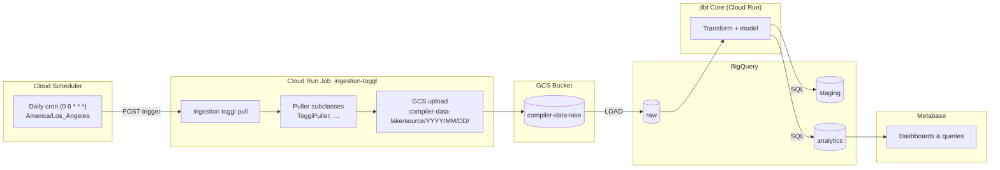

# Ingestion Architecture

This section explains the design of the data ingestion framework for Compiler's analytics warehouse.

## Architecture Overview



## Framework Design

### Puller Abstraction

Every ingestion source implements a `Puller` subclass:

```python
class Puller:
    source_name: str

    def pull(
        self,
        source: str,
        start_date: str | None = None,
        end_date: str | None = None,
    ) -> list[str]:
        ...
```

Subclasses set `source_name` (e.g., `"toggl"`) and implement `pull()` to:

1. Fetch data from the source (via API, CLI, or file)
2. Transform it as needed (e.g., CSV conversion, column injection)
3. Upload it to GCS via `upload_to_storage()`

### CLI Auto-Discovery

The CLI entry point (`ingestion.main`) uses `discover_pullers()` to find all `Puller` subclasses across the `ingestion/` package at import time. No manual registration is needed — adding a new source package under `ingestion/<source>/` with a `Puller` subclass is sufficient.

```bash
$ ingestion --help
Usage: ingestion [OPTIONS] COMMAND [ARGS]...

Data ingestion framework for Compiler's analytics warehouse.

Commands:
  toggl

$ ingestion toggl pull --help
Usage: ingestion toggl pull [OPTIONS]

Pull data for the given date range.

Options:
  --start TEXT  Start date (absolute or relative keyword)
  --end TEXT    End date (absolute or relative keyword)
```

### Date Range Resolution

The CLI supports flexible date inputs with three-level priority:

1. **CLI arguments** — `--start 2026-10-01 --end 2026-10-31`
2. **Environment variables** — `INGESTION_START_DATE`, `INGESTION_END_DATE`
3. **Defaults** — `"yesterday"` for both

Relative keywords are resolved at runtime:

| Keyword      | Meaning                             |
| ------------ | ----------------------------------- |
| `today`      | Current date                        |
| `yesterday`  | Previous date                       |
| `last-week`  | Monday–Sunday of last week          |
| `last-month` | First to last day of previous month |
| `2026-10-01` | Any valid ISO date                  |

### GCS Upload

The `upload_to_storage()` helper supports two output modes:

| Mode      | Trigger                   | Path                                                                    |
| --------- | ------------------------- | ----------------------------------------------------------------------- |
| **GCS**   | `BUCKET_NAME` env var set | `compiler-data-lake/<source>/<YYYY>/<MM>/<DD>/<name>_<timestamp>.<ext>` |
| **Local** | No bucket name            | `<OUTPUT_DIR>/<source>/<YYYY>/<MM>/<DD>/<name>_<timestamp>.<ext>`       |

For CSV files, a `pull_date` column is injected. For JSONL, a `pull_date` key is added to each record.

## Cloud Run Job Flow

Each ingestion source has a dedicated Cloud Run Job and Cloud Scheduler job:

| Component       | Name                    | Purpose                                                                       |
| --------------- | ----------------------- | ----------------------------------------------------------------------------- |
| Cloud Run Job   | `ingestion-toggl`       | Runs `ingestion toggl pull` with injected secrets and date keywords           |
| Cloud Scheduler | `ingestion-toggl-daily` | Triggers the job daily at 06:00 PST with `--start last-month --end yesterday` |

The Cloud Scheduler passes relative date keywords (`last-month`, `yesterday`) — the CLI resolves them to actual dates at runtime. This means the job always pulls the correct range regardless of when it executes.

## Per-Source Isolation

Each source gets its own:

- **Cloud Run Job** — isolated compute with its own CPU/memory limits
- **Cloud Scheduler job** — independent schedule and retry policy
- **Service account** — scoped IAM permissions (ingestion-runner SA with `roles/storage.objectCreator` and `roles/secretmanager.secretAccessor`)
- **Secrets** — source-specific secrets in Secret Manager (e.g., `TOGGL_API_TOKEN`)

## Downstream Processing

Landed raw data flows through:

```
GCS → BigQuery (raw dataset) → dbt Core (Cloud Run Job) → BigQuery (staging + analytics) → Metabase
```

dbt models handle deduplication and transformation, ensuring the analytics tables in BigQuery are clean and queryable by Metabase dashboards.

## Container Images

All images are built and pushed to GitHub Container Registry (GHCR):

| Image           | Path                                                 | Base                                                |
| --------------- | ---------------------------------------------------- | --------------------------------------------------- |
| Ingestion base  | `ghcr.io/compilerla/warehouse/ingestion/base:<sha>`  | `python:3.14-trixie`                                |
| Ingestion toggl | `ghcr.io/compilerla/warehouse/ingestion/toggl:<sha>` | `ghcr.io/compilerla/warehouse/ingestion/base:<sha>` |
| Metabase        | `ghcr.io/compilerla/warehouse/metabase:<sha>`        | `metabase/metabase:<tag>`                           |

Image tags use the git commit SHA (for tag-based deploys) or a user-provided value (for `workflow_dispatch`). OCI labels (`org.opencontainers.image.version`, `org.opencontainers.image.created`) are embedded in every image.
